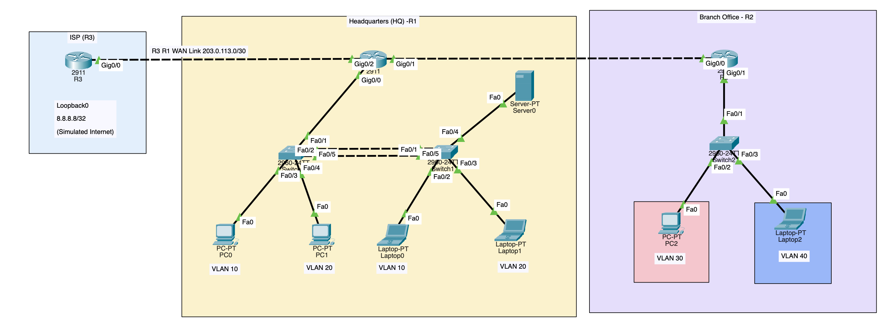

<div align="center">

# Enterprise Network Design & Implementation
### Cisco Packet Tracer | Multi-Site Enterprise Network

A hands-on enterprise networking lab connecting headquarters, a branch office, and a simulated ISP — with segmentation, routing, security, redundancy, and troubleshooting.


</div>

---

## Project at a glance

| | Details |
|---|---|
| **Project type** | Enterprise network simulation |
| **Platform** | Cisco Packet Tracer |
| **Sites** | Headquarters + branch + simulated ISP |
| **Core technologies** | VLANs, 802.1Q, DHCP, OSPF, NAT/PAT, ACLs |
| **Security** | SSH, port security, unused-port shutdown, ACL policies |
| **Resilience** | LACP EtherChannel, STP, PortFast, BPDU Guard |

## Network overview

The lab models a small multi-site organization. HQ and branch users are separated into VLANs, routers provide inter-VLAN connectivity, OSPF exchanges routes between sites, and an ISP router represents external connectivity.

**Devices**

- **R1 — HQ router:** HQ VLAN gateways, DHCP, OSPF, default route, and NAT/PAT as configured.
- **R2 — Branch router:** Branch VLAN gateways, DHCP, and OSPF.
- **R3 — ISP simulator:** Represents the external network for lab connectivity tests.
- **SW1 / SW2 — HQ switches:** VLAN access ports, trunks, and LACP EtherChannel.
- **SW3 — Branch switch:** Branch VLAN access and trunk connectivity.

> **Topology:** Open [`topology.pkt`](topology.pkt) in Cisco Packet Tracer to inspect the lab. If you add a topology screenshot, save it under `Docs/` and link it here.

## Network Topology

The following diagram illustrates the simulated enterprise network,
including headquarters, the branch office, and the ISP.

<p align="center">
  
</p>

## VLANs and IP addressing

| Location | VLAN | Purpose | Network | Default gateway |
|---|---:|---|---|---|
| HQ | 10 | Sales | `192.168.10.0/24` | `192.168.10.1` |
| HQ | 20 | IT | `192.168.20.0/24` | `192.168.20.1` |
| HQ | 99 | Additional HQ VLAN / management as configured | `192.168.99.0/24` | `192.168.99.1` |
| Branch | 30 | Branch users | `192.168.30.0/24` | `192.168.30.1` |
| Branch | 40 | Guest | `192.168.40.0/24` | `192.168.40.1` |
| Router transit | — | R1–R2 link | `10.0.0.0/30` | R1: `10.0.0.2`; R2: `10.0.0.1` |
| ISP transit | — | R1–R3 link | `203.0.113.0/30` | R1: `203.0.113.1`; confirm R3 in saved topology |

*Confirm all addressing and labels against the final Packet Tracer file before relying on this table. Any external test IP configured on R3 is simulated; this lab does not itself provide real internet access.*

## Features implemented

- **Segmentation:** VLANs and 802.1Q trunks
- **Inter-VLAN routing:** Router-on-a-stick
- **Addressing:** DHCP pools and excluded addresses
- **Dynamic routing:** OSPF area 0 between routers
- **External path simulation:** Default routing and NAT/PAT
- **Access control:** Extended ACLs for inter-VLAN policies
- **Device management:** SSH and local authentication
- **Layer 2 security:** Sticky MAC port security and unused-port shutdown
- **Redundancy:** LACP EtherChannel and Spanning Tree Protocol
- **Edge-port protection:** PortFast and BPDU Guard where appropriate
- **Operations:** CLI verification, fault isolation, and troubleshooting notes

## Security policy examples

- Sales (VLAN 10) should not initiate traffic to IT (VLAN 20).
- Guest (VLAN 40) should be restricted from internal networks according to the configured policy.
- Network-device administration should use SSH rather than Telnet.
- Unused switch ports should be disabled, and access ports should have appropriate port-security settings.

These are intended policy goals. Verify each against the saved configuration and test both permitted and denied traffic before describing it as enforced.

## Troubleshooting highlight: VLAN 10 DHCP

**Symptom:** VLAN 20 clients received DHCP addresses, but VLAN 10 clients did not.

**Investigation:** VLAN 10 access ports were up, port security showed `Secure-up` with zero violations, and R1's DHCP configuration was reviewed. The inbound `SALES_RESTRICTIONS` ACL on `R1 G0/0.10` did not explicitly allow the initial DHCP request, which uses source address `0.0.0.0` before the client receives an address.

**Fix applied:** Added an explicit DHCP client-to-server permit to the ACL:

```text
R1(config)# ip access-list extended SALES_RESTRICTIONS
R1(config-ext-nacl)# permit udp any eq 68 any eq 67
```

**Result:** VLAN 10 clients subsequently obtained DHCP addresses while the Sales-to-IT restriction remained in place.

More details: [`troubleshooting/troubleshooting.md`](troubleshooting/troubleshooting.md) *(adjust the path if your repository uses a different folder name or capitalization).* 

## Verification checklist

Run the relevant commands on your Packet Tracer devices and save evidence of the results.

<details>
<summary><strong>Switch checks</strong></summary>

```text
show vlan brief
show interfaces trunk
show interfaces status
show etherchannel summary
show spanning-tree
show port-security
show port-security interface fa0/3
```

</details>

<details>
<summary><strong>Router checks</strong></summary>

```text
show ip interface brief
show ip route
show ip ospf neighbor
show ip ospf database
show ip dhcp pool
show ip dhcp binding
show access-lists
show ip nat translations
show ip nat statistics
```

</details>

<details>
<summary><strong>End-to-end tests</strong></summary>

- [ ] Clients receive an address from the correct subnet.
- [ ] Each client can reach its default gateway.
- [ ] Allowed inter-VLAN traffic succeeds and restricted traffic is blocked.
- [ ] HQ and branch subnets can communicate as intended.
- [ ] The simulated external destination is reachable as configured.
- [ ] Disconnecting one EtherChannel member does not interrupt connectivity.

</details>

## Repository contents

```text
.
├── Configs/             # Exported router and switch configurations
├── Docs/                # Project notes and topology images
├── Passwords/           # Reference only; do not commit real credentials
├── troubleshooting/     # Troubleshooting reports and fixes
├── README.md
└── topology.pkt         # Cisco Packet Tracer project
```

## 🔐 Lab Access (Simulated Devices Only)

> ⚠️ **Lab-only credentials:** These credentials are used exclusively for this Cisco Packet Tracer simulation. Do not reuse them on production networks or real devices.

### Device Credentials

| Device | Role | Username | Password | Enable Secret |
|:---|:---|:---|:---|:---|
| R1 | Headquarters Router | `netadmin` | `NetLab#2026` | `NetLab#2026` |
| R2 | Branch Router | `netadmin` | `NetLab#2026` | `NetLab#2026` |
| R3 | Simulated ISP Router | `netadmin` | `NetLab#2026` | `NetLab#2026` |
| SW1 | Headquarters Switch 1 | `netadmin` | `NetLab#2026` | `NetLab#2026` |
| SW2 | Headquarters Switch 2 | `netadmin` | `NetLab#2026` | `NetLab#2026` |
| SW3 | Branch Switch | `netadmin` | `NetLab#2026` | `NetLab#2026` |

### SSH Access Example

```bash
ssh -l netadmin 192.168.99.1
```

When prompted, enter `NetLab#2026`.

**Notes:**
- SSH access requires SSH to be enabled and network connectivity to the target device.
- `192.168.99.1` is the VLAN 99 gateway address; verify that it is the intended SSH destination.
- The `enable secret` is used to enter privileged EXEC mode.
- Verify that these credentials match the final Packet Tracer configuration.

Keep only files that are actually present in the repository. **Never publish real passwords, private keys, tokens, or other credentials.** If `Passwords/` contains real credentials, remove them from the repository and rotate them before publishing.

## Open the project

1. Install Cisco Packet Tracer.
2. Clone or download this repository from GitHub.
3. Open `topology.pkt` in Packet Tracer.
4. Review the exported configurations in `Configs/`.
5. Run the verification checklist and compare results with the troubleshooting notes.

## Skills demonstrated

`VLANs` · `Routing & Switching` · `DHCP` · `OSPF` · `NAT/PAT` · `ACLs` · `SSH` · `Port Security` · `EtherChannel` · `STP` · `Troubleshooting` · `Technical Documentation`

## Author

**Kailasanathan R.**  
[LinkedIn](https://www.linkedin.com/in/kailasanathan-r/)

---

*Educational simulation only. Verify configuration details and security behavior against the included `.pkt` file and exported device configurations.*
